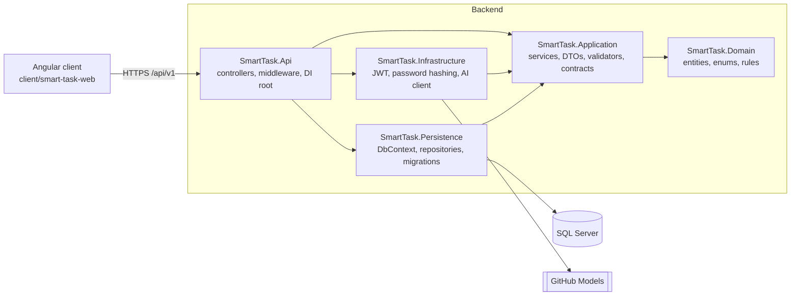
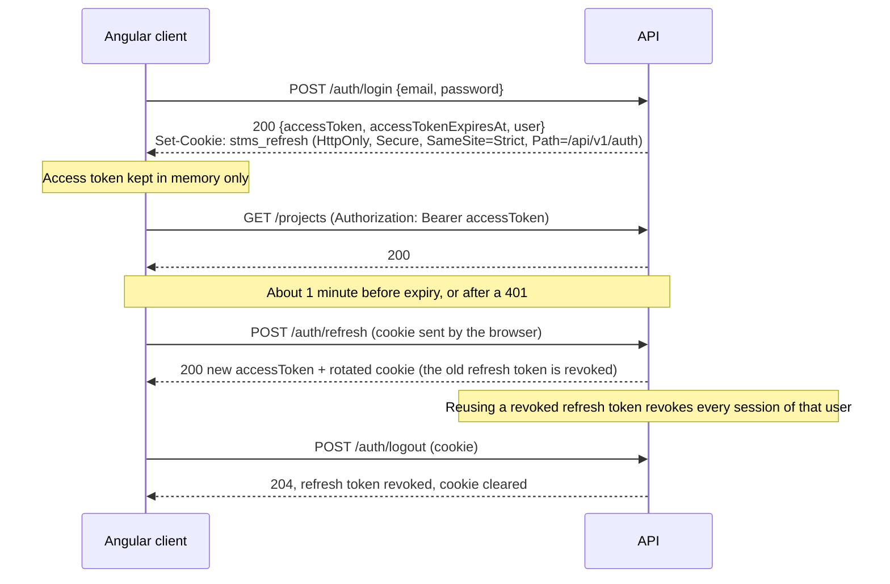

# Smart Task Management System

A full-stack task management application: users work in **projects**, each project has **tasks**, tasks
are assigned to project members, and a dashboard summarises the work. An AI endpoint rewrites rough task
descriptions into clear, actionable ones.

Backend: ASP.NET Core 10 Web API with Clean Architecture, EF Core 10 and SQL Server. Frontend: Angular 22.

- [1. Project Overview](#1-project-overview)
- [2. Technology Stack](#2-technology-stack)
- [3. Architecture](#3-architecture)
- [4. Setup Instructions](#4-setup-instructions)
- [5. Configuration](#5-configuration)
- [6. API Overview](#6-api-overview)
- [7. Security](#7-security)
- [8. Folder Structure](#8-folder-structure)
- [9. Testing](#9-testing)
- [10. Agentic Development Workflow](#10-agentic-development-workflow)
- [11. Known Limitations & Future Improvements](#11-known-limitations--future-improvements)

---

## 1. Project Overview

### Roles

| Action | Admin | ProjectManager | TeamMember |
|---|:---:|---|---|
| Manage users, change roles, create users with any role | ✅ | ❌ | ❌ |
| Create a project | ✅ | ✅ | ❌ |
| Update / delete a project, manage its members | ✅ | ✅ own projects | ❌ |
| View / list / search projects | ✅ all | ✅ owned or member of | ✅ member of |
| Create / update / delete / assign tasks | ✅ | ✅ in own projects | ❌ |
| Change a task's status | ✅ | ✅ in own projects | ✅ tasks assigned to them |
| Dashboard | ✅ global | ✅ own projects | ✅ own projects and tasks |
| Improve a description with AI, change own password | ✅ | ✅ | ✅ |

Self-registration always creates a **TeamMember**. Only an Admin can change roles or create accounts with
another role. A password set by an Admin is **temporary**: the user must choose a new one before using
anything else.

### Features

| Area | Feature | Status |
|---|---|:---:|
| Auth | Register, login, logout, JWT access tokens, rotating refresh tokens in an HttpOnly cookie | ✅ |
| Auth | Change password (signs out all other sessions); temporary passwords for admin-created users | ✅ |
| Auth | First Admin created from configuration on start-up | ✅ |
| Projects | Create, update, delete (soft), details, list, keyword search, start-date filter, sorting, paging | ✅ |
| Projects | Add and remove members | ✅ |
| Tasks | Create, update, delete (soft), assign, status transitions, priority, due date | ✅ |
| Tasks | Search, filter (status, priority, assignee, due range, overdue), sort, page; per project or across projects | ✅ |
| Dashboard | Totals, tasks by status and priority, completed vs pending, overdue, upcoming due tasks (7/14/30 days) | ✅ |
| AI | Improve a task description (GitHub Models; a fake provider runs without a key); shown side by side, user accepts or discards | ✅ |
| Users | Admin user list with role/status filters, create user, change role, activate/deactivate | ✅ |
| Platform | Swagger, Serilog, health checks, rate limiting, global exception handling, consistent responses | ✅ |
| Platform | Docker Compose for SQL Server + API | ✅ |
| Platform | Docker image for the Angular client | ⏳ the compose service is prepared but commented out |

There are no screenshots yet.

---

## 2. Technology Stack

Versions are taken from the `.csproj` files and `client/smart-task-web/package.json`.

| Area | Technology |
|---|---|
| Runtime | .NET 10 (`net10.0`, SDK 10.0.4xx), C# `latest`, nullable enabled, warnings as errors |
| Web API | ASP.NET Core 10, Swashbuckle.AspNetCore 11.0.0 (Swagger / OpenAPI) |
| Data | EF Core 10.0.14 + SQL Server (LocalDB for development, SQL Server 2022 in Docker), code-first migrations |
| Validation | FluentValidation 12.2.0 |
| Security | JwtBearer 10.0.14, Microsoft.IdentityModel.JsonWebTokens 8.23.0, ASP.NET Core Identity `PasswordHasher` (PBKDF2) |
| Logging | Serilog.AspNetCore 10.0.0 (console + rolling JSON file) |
| AI | Microsoft.Extensions.AI.OpenAI 11.0.0 → GitHub Models (`openai/gpt-4.1-mini`), OpenAI-compatible |
| Health | Microsoft.Extensions.Diagnostics.HealthChecks.EntityFrameworkCore 10.0.14 |
| Frontend | Angular 22.2 (standalone components, signals, zoneless, OnPush), Angular Material 22.2, TypeScript 6.0, RxJS 7.8 |
| Charts | Chart.js 4.6 via ng2-charts 11 (lazy-loaded) |
| Backend tests | xUnit 2.9.3, Shouldly 4.3.0, NSubstitute 6.2.0, Microsoft.AspNetCore.Mvc.Testing 10.0.14, EF Core SQLite 10.0.14 |
| Frontend tests | Vitest 5 + jsdom (Angular CLI unit-test builder), ESLint 10 with angular-eslint 22 |
| Containers | Docker Compose: SQL Server 2022, a one-shot init container, the API |

---

## 3. Architecture

Clean Architecture. Dependencies point inwards only; the Domain has no dependencies at all.



| Layer | Responsibility |
|---|---|
| **Domain** | Entities (`User`, `Project`, `ProjectMember`, `TaskItem`, `RefreshToken`) with private setters and factory methods, enums, shared length/limit constants, the task status transition table, domain exceptions. |
| **Application** | One service per feature with the use cases and permission checks; Create/Update/Read DTOs with explicit mapping methods (no AutoMapper); FluentValidation validators; contracts for persistence, identity and AI. No EF Core. |
| **Persistence** | `SmartTaskDbContext`, entity configurations (using the Domain constants), repositories that return entities, read models or `PagedResult<T>` (never `IQueryable`), Unit of Work, audit and soft-delete interceptors, migrations, development seed data. |
| **Infrastructure** | JWT creation, refresh-token generation and hashing, the password hasher adapter, the GitHub Models client and the fake AI provider. |
| **Api** | Thin controllers on `BaseApiController`, the middleware pipeline, authentication and authorization, rate limiting, Swagger, health checks, the global exception handler. |

### Design patterns and why

| Pattern | Where | Why |
|---|---|---|
| Repository | `Application/Contracts/Persistence` + `Persistence/Repositories` | Keeps EF Core out of the use cases; services can be unit-tested with substitutes. |
| Unit of Work | `IUnitOfWork` | One `SaveChanges` per use case, so each use case is one transaction. Concurrency and unique-index violations become `ConflictException` (409). |
| Service layer | `Application/Services/<Feature>` | All business rules and permission checks in one place; controllers are one line per action. |
| Result object | `BaseResponse` / `BaseResponse<T>` | Expected failures (404, 403, 409) are returned, not thrown, and every endpoint has the same response shape. |
| Template method | `BaseApiController.ToActionResult` | One mapping from service status to HTTP result for every controller. |
| Strategy | `ITaskDescriptionImprover` (GitHub Models / fake), `IRefreshTokenTransport` (cookie) | Swap the AI provider or token transport through configuration without touching use cases. |
| Options | `JwtOptions`, `AiOptions`, `RateLimitingOptions` | Strongly typed configuration, validated at start-up (fail fast). |
| Factory method | Entity `Create(...)` methods | An entity is valid from the moment it is constructed. |
| Pipeline filter | `ValidationFilter` | FluentValidation runs for every action argument without code in controllers. |

On the client: functional interceptors and guards, a feature-per-folder layout with a `data-access` service
per feature, and a single shared task list component for both the global and the per-project task lists.

More detail: [docs/ARCHITECTURE.md](docs/ARCHITECTURE.md), [docs/DOMAIN-MODEL.md](docs/DOMAIN-MODEL.md),
[docs/API-CONVENTIONS.md](docs/API-CONVENTIONS.md), [docs/CONVENTIONS.md](docs/CONVENTIONS.md).

---

## 4. Setup Instructions

### Prerequisites

- [.NET SDK 10](https://dotnet.microsoft.com/download)
- [Node.js](https://nodejs.org/) LTS (developed with Node 24, npm 11)
- SQL Server: **LocalDB** (installed with Visual Studio) for the default connection string, or any SQL
  Server instance, or Docker (see [Run with Docker](#run-the-backend-with-docker))
- The EF Core tool, restored from `dotnet-tools.json`: `dotnet tool restore`

### Steps (local development)

All `dotnet` commands run from the repository root.

1. **Clone and restore**

   ```bash
   git clone <repository-url> TaskPlus
   cd TaskPlus
   dotnet tool restore
   dotnet build SmartTask.slnx
   ```

2. **Set the secrets** with user-secrets (stored outside the repository). `Jwt:SigningKey` is required:
   the API refuses to start without a key of at least 32 bytes.

   ```bash
   dotnet user-secrets set "Jwt:SigningKey" "<64+ random characters>" -p src/SmartTask.Api

   # Optional: sample data for development (three users, two projects with tasks)
   dotnet user-secrets set "Seed:Enabled" "true" -p src/SmartTask.Api
   dotnet user-secrets set "Seed:AdminPassword"   "<password>" -p src/SmartTask.Api
   dotnet user-secrets set "Seed:ManagerPassword" "<password>" -p src/SmartTask.Api
   dotnet user-secrets set "Seed:MemberPassword"  "<password>" -p src/SmartTask.Api

   # Optional: real AI (a GitHub fine-grained token with models:read). Without it a fake provider answers.
   dotnet user-secrets set "Ai:ApiKey" "<github-token>" -p src/SmartTask.Api
   ```

   Passwords must be 8–128 characters with an upper-case letter, a lower-case letter, a digit and a
   symbol, and must not contain the email's local part.

3. **Connection string.** The default in `appsettings.json` is
   `Server=(localdb)\MSSQLLocalDB;Database=SmartTask;Trusted_Connection=True;TrustServerCertificate=True`.
   To use another server:

   ```bash
   dotnet user-secrets set "ConnectionStrings:DefaultConnection" "<connection string>" -p src/SmartTask.Api
   ```

4. **Create the database** with the migrations, or with the generated script (see
   [database/README.md](database/README.md)):

   ```bash
   dotnet ef database update -p src/SmartTask.Persistence -s src/SmartTask.Api
   ```

   With `Seed:Enabled=true` the API also applies pending migrations itself when it starts in Development.

5. **Run the API** on `https://localhost:7180` (Swagger UI: <https://localhost:7180/swagger>):

   ```bash
   dotnet dev-certs https --trust
   dotnet run --project src/SmartTask.Api --launch-profile https
   ```

6. **Run the Angular client** on `http://localhost:4200`:

   ```bash
   cd client/smart-task-web
   npm ci
   npm start
   ```

   The dev server forwards `/api` to `https://localhost:7180` (`proxy.conf.json`), so the browser stays
   on one origin and the `SameSite=Strict` refresh cookie works.

7. **Sign in.** With the seed data enabled, the accounts are `admin@smarttask.local`,
   `manager@smarttask.local` and `member@smarttask.local`, with the passwords you set in step 2.
   Otherwise register a TeamMember account, or configure a first Admin (see [Configuration](#5-configuration)).

### Run the backend with Docker

```bash
cp .env.example .env      # fill in every value; generate strong random secrets
docker compose up -d --build
```

This starts SQL Server 2022, a one-shot container that creates the database and an application login,
and the API on `https://localhost:7180` with migrations applied on start-up and Swagger enabled. The data
lives in volumes, so it survives `docker compose down`. Set the `BOOTSTRAP_ADMIN_*` values in `.env` to
get a first Admin. Then run the Angular client as in step 6. Details: [docs/WORKFLOW.md](docs/WORKFLOW.md#run-with-docker).

### Troubleshooting

| Problem | Fix |
|---|---|
| Browser or `npm start` proxy errors about the certificate | Run `dotnet dev-certs https --trust`. The proxy itself accepts the dev certificate (`secure: false`). |
| API exits with `Jwt:SigningKey must be at least 32 bytes` | Set `Jwt:SigningKey` (step 2) or the `Jwt__SigningKey` environment variable. |
| CORS error in the browser | Only needed when the client calls the API directly (not through the proxy). Add the client's origin to `Cors:AllowedOrigins`. |
| `A network-related or instance-specific error` | Check that LocalDB is running (`sqllocaldb start MSSQLLocalDB`) or fix the connection string. `/health/ready` returns 503 while the database is unreachable. |
| Signed out after every page reload | The refresh cookie is `Secure` and scoped to `/api/v1/auth`. Use the proxy on `http://localhost:4200`, or HTTPS when calling the API directly. |
| 429 Too Many Requests on login | The `auth` rate limit allows 5 requests per minute per IP. Wait a minute. |

---

## 5. Configuration

Settings are read from `appsettings.json`, `appsettings.{Environment}.json`, user-secrets (Development)
and environment variables (`__` for nesting, e.g. `Jwt__SigningKey`). **Secrets are never in source
files.** All option classes are validated when the API starts.

| Setting | Default | Secret | Purpose |
|---|---|:---:|---|
| `ConnectionStrings:DefaultConnection` | LocalDB `SmartTask` | — | SQL Server connection string (no password in files) |
| `Database:Password` | — | ✅ | Added to the connection string when set (used by Docker) |
| `Database:ApplyMigrationsOnStartup` | `false` (`true` in a container) | — | Apply pending migrations at start-up |
| `Database:MaxRetryCount` / `MaxRetryDelaySeconds` | `6` / `30` | — | SQL transient-failure retries |
| `Jwt:Issuer` / `Jwt:Audience` | `SmartTask.Api` / `SmartTask.Web` | — | Token issuer and audience |
| `Jwt:SigningKey` | — | ✅ | HMAC signing key, at least 32 bytes (required) |
| `Jwt:AccessTokenMinutes` / `RefreshTokenDays` | `15` / `7` | — | Token lifetimes |
| `Cors:AllowedOrigins` | `http://localhost:4200` | — | Origins allowed to call the API with credentials |
| `RateLimiting:Global` | 100 / 60 s | — | Fixed window per user (or IP) for all endpoints |
| `RateLimiting:Auth` | 5 / 60 s, 6 segments | — | Sliding window per IP: register, login, refresh, change password |
| `RateLimiting:Ai` | 10 tokens, +10 per 60 s | — | Token bucket per user for the AI endpoint |
| `Ai:Provider` | `GitHubModels` | — | `GitHubModels` or `Fake` |
| `Ai:Endpoint` / `Ai:Model` | GitHub Models / `openai/gpt-4.1-mini` | — | Any OpenAI-compatible endpoint (HTTPS only) |
| `Ai:ApiKey` | — | ✅ | Provider key; when empty the fake provider is used |
| `Ai:TimeoutSeconds` / `MaxOutputTokens` / `Temperature` | `20` / `600` / `0.3` | — | Call limits |
| `Swagger:Enabled` | `false` (always on in Development) | — | Serve Swagger outside Development |
| `Seed:Enabled` | `false` | — | Development sample data (Development environment only) |
| `Seed:AdminPassword` / `ManagerPassword` / `MemberPassword` | — | ✅ | Passwords for the seeded users |
| `Bootstrap:Admin:FirstName` / `LastName` / `Email` / `Password` | — | ✅ (password) | The deployment's first Admin |
| `Serilog` | console + `logs/smarttask-.log` (daily, 14 files, compact JSON) | — | Log levels and sinks |

### First Admin

1. Set `Bootstrap:Admin:*` (user-secrets or environment variables; the `BOOTSTRAP_ADMIN_*` values in the
   Docker `.env`).
2. On start-up the API creates that Admin **only if no Admin exists yet**. It never overwrites a password,
   and it never promotes an existing account that already uses the email, so nobody can pre-register the
   admin address. Without these settings it does nothing.
3. That Admin then creates other accounts with `POST /api/v1/users` (any role, temporary password) or
   promotes self-registered users with `PATCH /api/v1/users/{id}/role`.

---

## 6. API Overview

Base path: `/api/v1`. Interactive documentation: Swagger UI at `https://localhost:7180/swagger`
(Development). Exports: [docs/api/openapi.json](docs/api/openapi.json), and a Postman collection
[docs/api/SmartTask.postman_collection.json](docs/api/SmartTask.postman_collection.json) with an
environment [docs/api/postman_environment.json](docs/api/postman_environment.json). The Login and Refresh
requests save the access token automatically; Postman keeps the refresh cookie.

### Endpoints

Roles: **A** = Admin, **PM** = ProjectManager, **TM** = TeamMember. "Scoped" means the result depends on
what the caller may see. Resource rules (owner, member, assignee) are checked in the services.

| Verb | Route | Roles | Description |
|---|---|---|---|
| POST | `auth/register` | anonymous | Create a TeamMember account (rate limit `auth`) |
| POST | `auth/login` | anonymous | Sign in; returns an access token and sets the refresh cookie (`auth`) |
| POST | `auth/refresh` | anonymous (cookie) | New access token; rotates the refresh cookie (`auth`) |
| POST | `auth/logout` | anonymous (cookie) | Revoke the refresh token and clear the cookie |
| GET | `users/me` | any | Current user (allowed while a password change is required) |
| PUT | `users/me` | any | Update own first and last name |
| POST | `users/me/password` | any | Change own password; signs out other sessions (`auth`; allowed while a change is required) |
| GET | `users` | A | Paged user list (role, active, search, sort) |
| POST | `users` | A | Create a user with any role and a temporary password |
| GET | `users/lookup?search=` | A, PM | Up to 20 active users, for member and assignee pickers |
| GET | `users/{id}` | A | User details |
| PATCH | `users/{id}/role` | A | Change a role (not your own) |
| POST | `users/{id}/activate` | A | Re-activate a user |
| POST | `users/{id}/deactivate` | A | Deactivate a user and revoke their refresh tokens (not yourself) |
| GET | `projects` | any (scoped) | Paged project list |
| POST | `projects` | A, PM | Create a project owned by the caller |
| GET | `projects/{id}` | any (owner, member or A) | Project with owner, members and task counts |
| PUT | `projects/{id}` | A, PM owner | Update a project |
| DELETE | `projects/{id}` | A, PM owner | Soft-delete a project and its tasks |
| POST | `projects/{id}/members` | A, PM owner | Add a member |
| DELETE | `projects/{id}/members/{userId}` | A, PM owner | Remove a member (not the owner) |
| GET | `projects/{projectId}/tasks` | any (owner, member or A) | Paged tasks of one project |
| POST | `projects/{projectId}/tasks` | A, PM owner | Create a task (starts as ToDo) |
| GET | `tasks` | any (scoped) | Paged tasks across all visible projects |
| GET | `tasks/{id}` | any (owner, member or A) | Task details |
| PUT | `tasks/{id}` | A, PM owner | Update title, description, priority and due date |
| DELETE | `tasks/{id}` | A, PM owner | Soft-delete a task |
| PATCH | `tasks/{id}/status` | A, PM owner, TM assignee | Change status (transition rules enforced) |
| PATCH | `tasks/{id}/assignee` | A, PM owner | Assign to a project member, or unassign with `null` |
| GET | `dashboard?upcomingDays=7` | any (scoped) | Statistics; `upcomingDays` 1–30 |
| POST | `ai/task-descriptions/improve` | any | Improve a description; nothing is saved (rate limit `ai`) |
| GET | `/health/live`, `/health/ready` | anonymous | Process up / database reachable (not versioned, not rate limited) |

Task status transitions: ToDo → InProgress, Completed, Cancelled; InProgress → ToDo, Completed, Cancelled;
Completed → InProgress; Cancelled → ToDo.

### Response envelope

Every response, including validation, authorization, rate-limit and unhandled errors, uses the same shape
(camelCase, nulls omitted). A `204` has no body.

```json
{
  "statusCode": 200,
  "success": true,
  "data": { "id": "0199f7c2-…", "name": "Website relaunch", "startDate": "2026-11-11" },
  "traceId": "0HN8…:00000001"
}
```

```json
{
  "statusCode": 400,
  "success": false,
  "message": "Validation failed.",
  "errors": { "endDate": ["End date must be on or after the start date."] },
  "traceId": "0HN8…:00000002"
}
```

401 and 403 responses carry an `errorCode`: `AUTH_REQUIRED`, `TOKEN_EXPIRED`, `TOKEN_INVALID`,
`INSUFFICIENT_ROLE`, `RESOURCE_FORBIDDEN` or `PASSWORD_CHANGE_REQUIRED`. A resource the caller may not see
returns 404, not 403, so ids can't be probed. See [docs/API-CONVENTIONS.md](docs/API-CONVENTIONS.md).

### Authentication flow



After a page reload the client calls `auth/refresh` once at start-up to restore the session. Parallel
requests that get a 401 share a single refresh and are each retried once.

### Paging, sorting and filtering

All list endpoints accept `pageNumber` (from 1), `pageSize` (1–100, default 10), `search` (up to 100
characters), `sortBy` and `sortDirection` (`Asc` / `Desc`). Sort fields are whitelisted; any other value
returns 400. Paged responses return `items`, `pageNumber`, `pageSize`, `totalCount`, `totalPages`,
`hasPreviousPage` and `hasNextPage`.

| Endpoint | Filters | `sortBy` values (default `createdAt`) |
|---|---|---|
| `GET projects` | `ownerId`, `startDateFrom`, `startDateTo` | `name`, `startDate`, `endDate`, `createdAt` |
| `GET tasks`, `GET projects/{id}/tasks` | `projectId`, `status`, `priority`, `assigneeId`, `dueDateFrom`, `dueDateTo`, `isOverdue` | `title`, `dueDate`, `priority`, `status`, `createdAt` |
| `GET users` | `role`, `isActive` | `name`, `email`, `createdAt` |

Dates are `yyyy-MM-dd`.

---

## 7. Security

| Requirement | Implementation |
|---|---|
| **JWT authentication** | HMAC-SHA256 access tokens, 15 minutes. Issuer, audience, lifetime and signature are validated (30 s clock skew). The token carries the user id, email, name, role, a token id and, for a temporary password, `pwd_change=required`. |
| **Refresh tokens** | 7 days, random, stored only as a SHA-256 hash. Rotated on every refresh. Reusing a revoked token revokes all of the user's sessions. Sent as an `HttpOnly`, `Secure`, `SameSite=Strict` cookie limited to `/api/v1/auth`, so scripts can't read it and other sites can't send it. |
| **Password hashing** | ASP.NET Core Identity `PasswordHasher` (PBKDF2 with HMAC-SHA512 and a random salt), behind `IPasswordHasher`. Hashes are re-computed when the algorithm settings change. |
| **Role-based authorization** | `[Authorize(Roles = …)]` on every controller with a class-level baseline, narrowed per action. The default and fallback policies require an authenticated user with a known role. Role failures return 403 `INSUFFICIENT_ROLE`. |
| **Resource authorization** | The services check ownership, membership and assignment (`IProjectAccessGuard`). Resources the caller can't see return 404. |
| **Temporary passwords** | An admin-set password lets the user call only `GET users/me` and `POST users/me/password`. Everything else returns 403 `PASSWORD_CHANGE_REQUIRED` until they change it. |
| **HTTPS** | `UseHttpsRedirection` everywhere and `UseHsts` outside Development. Docker serves HTTPS on 7180. |
| **CORS** | One named policy: only the origins in `Cors:AllowedOrigins`, with credentials. |
| **Input validation** | FluentValidation for every request body and query object (global `ValidationFilter`), with the same length constants as the database schema. The Angular forms mirror the rules. Sort fields are whitelisted; no dynamic SQL. |
| **Rate limiting** | Global 100/min per user or IP; `auth` 5/min per IP; `ai` 10/min per user. Rejections return 429 with `Retry-After`. |
| **Secure configuration** | No secrets in source: user-secrets or environment variables only. Options are validated at start-up (for example the signing key length). Logs never contain passwords, tokens or AI prompts; DTOs with secrets override `ToString()`. |
| **Security headers** | `X-Content-Type-Options: nosniff`, `X-Frame-Options: DENY`, `Referrer-Policy: no-referrer`, and `Content-Security-Policy: default-src 'none'; frame-ancestors 'none'` on API responses. |
| **Error handling** | The global exception handler returns a generic 500 with a trace id; stack traces are never sent. |
| **Client** | The access token is kept in memory only (never in browser storage). The return URL after login must be a path inside the app. Hidden actions are UX only; the API enforces every rule. |

---

## 8. Folder Structure

```text
TaskPlus/
├── SmartTask.slnx                 solution
├── Directory.Build.props          shared build settings (net10.0, nullable, warnings as errors)
├── docker-compose.yml, .env.example, docker/   SQL Server + API containers
├── database/                      generated SQL script (SmartTask.sql) and how to apply it
├── docs/                          architecture, domain model, API conventions, workflow, progress log
│   └── api/                       OpenAPI export, Postman collection and environment
├── src/
│   ├── SmartTask.Domain/          Entities, Enums, Constants (lengths/limits), Exceptions
│   ├── SmartTask.Application/
│   │   ├── Contracts/             Persistence, Identity, Ai and Services interfaces
│   │   ├── Common/                BaseResponse, PagedResult, query parameter models, exceptions
│   │   ├── DTOs/                  Create/Update/Read DTOs and mapping extensions per feature
│   │   ├── Validators/            FluentValidation validators per feature
│   │   └── Services/              use cases per feature (Auth, Users, Projects, Tasks, Dashboard, Ai)
│   ├── SmartTask.Persistence/     DbContext, Configurations, Repositories, Interceptors, Migrations, Seed
│   ├── SmartTask.Infrastructure/  Identity (JWT, refresh tokens, hashing) and Ai (GitHub Models, fake)
│   └── SmartTask.Api/             Controllers, Middleware, Filters, Authorization, RateLimiting, Swagger, Extensions
├── tests/
│   ├── SmartTask.Domain.UnitTests/
│   ├── SmartTask.Application.UnitTests/      services and validators
│   ├── SmartTask.Infrastructure.UnitTests/   JWT, hashing, AI providers
│   └── SmartTask.Api.IntegrationTests/       full HTTP pipeline with WebApplicationFactory
└── client/smart-task-web/         Angular app
    └── src/app/
        ├── core/                  auth (AuthService, memory token storage), guards, interceptors,
        │                          http (API models, helpers), layout (shell), models (enums, limits)
        ├── shared/                components (dialogs, chips, user picker), forms (validators,
        │                          server-error mapping), pipes, utils (dates, URL query state)
        ├── features/              auth, account, dashboard, projects, tasks, users
        │                          (each with its routes and a data-access service)
        ├── app.routes.ts          lazy routes and guards
        └── app.config.ts          router, HTTP client + interceptors, session restore
```

---

## 9. Testing

```bash
# Backend (from the repo root)
dotnet test SmartTask.slnx

# Frontend
cd client/smart-task-web
npm run lint
npm test -- --watch=false
npm run build
```

| Project | Tests | Covers |
|---|---:|---|
| SmartTask.Domain.UnitTests | 58 | Entity invariants, status transitions, membership, refresh-token rules |
| SmartTask.Application.UnitTests | 357 | Every service (permissions, outcomes, status codes) and every validator |
| SmartTask.Infrastructure.UnitTests | 60 | JWT creation, password hashing, AI client parsing and failure mapping, no secrets in logs |
| SmartTask.Api.IntegrationTests | 78 | The real pipeline over HTTP: auth flow and cookies, role and resource rules, error codes, validation, rate limits, temporary-password flow |
| Angular (Vitest) | 46 | Guards, refresh interceptor (one refresh for parallel 401s, retry, sign-out), session restore, form validators and server-error mapping, data-access URLs, route behaviour |
| **Total** | **599** | |

Counts are from the last run on 2026-11-11.

---

## 10. Agentic Development Workflow

The project was built with Claude Code, one step at a time, using custom slash commands in
[`.claude/commands/`](.claude/commands): `/create-domain`, `/create-repositories`, `/create-dto`,
`/implement-validators`, `/create-features`, `/implement-auth`, `/create-api`, `/implement-ai`,
`/implement-authorization`, `/deploy-backend-services`, `/create-angular-feature` and `/write-docs`.
Each command reads the specifications in `docs/`, keeps to its own layer, must leave the build and tests
passing, and records what it did in [docs/PROGRESS.md](docs/PROGRESS.md). [CLAUDE.md](CLAUDE.md) holds
the shared rules (architecture, dependency direction, security rules) that every command follows.
How to use the commands: [docs/WORKFLOW.md](docs/WORKFLOW.md).

---

## 11. Known Limitations & Future Improvements

- **Access tokens can't be revoked early.** A deactivated user or a changed role takes effect when the
  current access token expires (at most 15 minutes) or at the next refresh. A per-request "still active"
  check is a possible follow-up.
- **No email flows:** no email verification, no "forgot password" reset.
- **AI examples are illustrative.** PROMPTS.md shows hand-written examples for the real model, because no
  API key was configured when the documentation was written. The fake-provider output is real.
- **The Angular client is not containerised yet.** The compose service is prepared but commented out.
- **The Angular client hasn't been tested end-to-end in a browser against the API.** It is covered by
  unit tests only, and the responsive layouts were not checked visually.
- **No screenshots** in this README yet.
- **Repository integration tests on SQL Server** (for example with Testcontainers) are not written; the API
  integration tests use SQLite.
- Project and task lists don't show edit/delete actions inline, because the summary DTOs don't include the
  owner or assignee id; those actions are on the detail pages.
